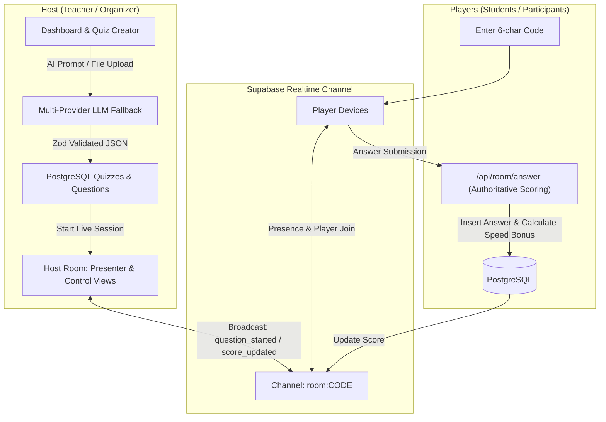

# Huddle 🚀

> **AI-Powered Live Multiplayer Quiz Platform**  
> Create quizzes instantly with AI, host high-energy live games, and watch leaderboards update in real-time.

---

## 🌟 Overview

**Huddle** is a real-time multiplayer quiz and trivia platform inspired by Kahoot and Quizizz, engineered from the ground up with modern full-stack web technologies. 

With Huddle, hosts can generate full-fledged quizzes in seconds from AI prompts or uploaded documents (PDF, DOCX, PPTX, TXT), customize questions, and host live sessions. Players join instantly on mobile or desktop using a 6-character room code or QR code—no app install or account creation required.

---

## ✨ Key Features

### 1. 🤖 Multi-Modal AI Quiz Generation
- **Prompt to Quiz**: Turn any topic, concept, or curriculum into a formatted quiz in seconds.
- **Document Ingestion**: Upload documents (PDF, Word DOCX, PowerPoint PPTX, or TXT up to 20MB) to extract text and synthesize grounded quiz questions with plausible distractors.
- **AI Question Rewriter**: Refine questions in the editor with custom instructions (e.g., *"make it more challenging"*, *"simplify the options"*, or *"add real-world context"*).
- **Manual Question Builder**: Full drag-and-drop question reordering, custom timer settings, point weightings, and image illustrations.

### 2. ⚡ Real-Time Multiplayer Room Engine
- **Zero-Friction Player Join**: Anonymous joining via 6-character room code or QR code with custom player names and 10+ avatar options.
- **Supabase Realtime Broadcast & Presence**: Instant lobby synchronization, player status tracking, and live host moderation (kick player capability).
- **Dual Host Modes**:
  - **Presenter View**: High-impact big-screen visual display for projectors and screenshares with QR codes, active questions, countdown animations, and live podiums.
  - **Control View**: Mobile-optimized host console for advancing questions, extending timers on the fly, and monitoring player answer distributions.
- **Server-Authoritative Clock**: Prevents client-side manipulation; timers and response times are strictly computed from server timestamps.
- **Resilient Reconnect**: Dropped players can seamlessly rejoin within their session token without losing points or leaderboard positions.

### 3. 🏆 Staggered Rising Podium & Leaderboard Animations
- **Climbing Leaderboard Rows**: Staggered rise-up animations (`animate-rise-up`) where players climb the ranks from below.
- **Dynamic shadcn Progress Bars**: Real-time score filling bars styled with podium tier colors (gold, silver, bronze, primary).
- **Growing Podium Pedestals**: Kahoot-style animated 3-step podium where 3rd, 2nd, and 1st place pedestals rise sequentially (`animate-pedestal`) with crown bounce and confetti bursts.

### 4. 📅 Scheduling & Email Invites (Vercel Edge & EmailJS)
- **Scheduled Sessions**: Plan quizzes ahead with timezone support and date-time pickers.
- **Email Invites & ICS Attachments**: Send calendar invitations powered by **EmailJS** with 1-click join links and `.ics` calendar files.
- **Vercel Edge Scheduling (No Cron Required)**: High-performance on-demand Edge Functions (`/api/schedule`) handle session creation, invite delivery, and reminder dispatches globally with zero cold starts, completely removing the need for an external cron job or paid Vercel Cron tier.

### 5. 📊 Post-Quiz Analytics & CSV Export
- **Comprehensive Reports**: Total participants, question accuracy, average response times, and most-missed questions.
- **Per-Player Metrics**: View exact counts of correct answers, wrong answers, and overall accuracy percentages for each participant.
- **One-Click CSV Export**: Download complete student/participant performance sheets.

### 6. 🎨 Workspace UI & Dark/Light Theme Support
- Modern curved workspace layout with floating sidebar and card spacing.
- Full dark mode and light mode support with Tailwind v4 custom class variants.

---

## 🛠️ Tech Stack

| Layer | Technology |
|---|---|
| **Framework** | [Next.js 16](https://nextjs.org/) (App Router, Turbopack, React 19) |
| **Language** | [TypeScript](https://www.typescriptlang.org/) (Strict mode) |
| **Styling** | [Tailwind CSS v4](https://tailwindcss.com/), `tw-animate-css`, CSS Keyframes |
| **Component Library** | [shadcn/ui](https://ui.shadcn.com/) (Radix / Base UI primitives) |
| **Database & Auth** | [Supabase](https://supabase.com/) (PostgreSQL, Row Level Security, Google OAuth) |
| **Realtime Engine** | Supabase Realtime (Channels, Broadcast, Presence) |
| **Storage** | Supabase Storage (Document uploads, Quiz covers, Avatars) |
| **AI Providers** | Google Gemini 2.5 Flash, Groq (Llama 3.3 70B), OpenRouter with automatic fallback chain |
| **Document Parsers** | `pdf-parse`, `mammoth` (DOCX), XML-based PPTX text parser |
| **Email & Calendar** | [EmailJS](https://www.emailjs.com/) REST API & `ics` calendar generator |
| **Icons & Visuals** | `lucide-react`, `canvas-confetti`, `qrcode.react`, `@dnd-kit` |
| **Testing** | Node.js Test Runner + `tsx` (Unit, Validation, Simulation tests) |

---

## 🏗️ Architecture & How It Works



### Server-Authoritative Scoring Formula
Points are calculated based on both correctness and speed:

$$\text{Points} = \text{Base Points} \times \left(0.5 + 0.5 \times \frac{\text{Timer} - \text{Response Time}}{\text{Timer}}\right)$$

- **Instant Correct Answer ($0\text{s}$)**: $100\%$ points ($1000$ pts base $\to 1000$ pts).
- **Mid-Timer Answer**: Proportional speed bonus awarded.
- **Deadline Answer ($t = \text{Timer}$)**: $50\%$ base points ($500$ pts).
- **Incorrect or Expired Answer**: $0$ pts.

---

## 🚀 Getting Started

### 1. Prerequisites
- **Node.js** 20.x or higher
- **npm** or **pnpm**
- A **Supabase** project
- (Optional) API keys for **Google Gemini**, **Groq**, **OpenRouter**, and **Resend**

### 2. Clone the Repository
```bash
git clone https://github.com/Nitinverma9784/huddle.git
cd huddle
npm install
```

### 3. Setup Environment Variables
Create a `.env.local` file in the root directory:
```env
# Supabase Configuration
NEXT_PUBLIC_SUPABASE_URL=https://your-project.supabase.co
NEXT_PUBLIC_SUPABASE_ANON_KEY=your-anon-key
SUPABASE_SERVICE_ROLE_KEY=your-service-role-key

# App URL
NEXT_PUBLIC_SITE_URL=http://localhost:3000

# AI Provider Keys (Chain: Gemini -> Groq -> OpenRouter)
GEMINI_API_KEY=your-gemini-key
GROQ_API_KEY=your-groq-key
OPENROUTER_API_KEY=your-openrouter-key

# Email & Scheduled Invites (EmailJS REST API)
EMAILJS_SERVICE_ID=service_xxxxxxx
EMAILJS_TEMPLATE_ID=template_xxxxxxx
EMAILJS_PUBLIC_KEY=your_emailjs_public_key
EMAILJS_PRIVATE_KEY=your_emailjs_private_key # optional access token
```

### 4. Database Setup
Run the database migration found in `supabase/migrations/20260220000000_init_schema.sql` inside your Supabase SQL Editor.

### 5. Run Development Server
```bash
npm run dev
```
Open [http://localhost:3000](http://localhost:3000) in your browser.

### 6. Run Tests & Validation
```bash
npm run test
npm run typecheck
```

---

## 👨‍💻 Author

Crafted with ❤️ by **Nitin Verma**

- **GitHub**: [@Nitinverma9784](https://github.com/Nitinverma9784)
- **Twitter / X**: [@damnitin](https://x.com/damnitin)
- **LinkedIn**: [Nitin Verma](https://www.linkedin.com/in/nitinvermaaa/)
- **Instagram**: [@nitinvermaaaa_](https://www.instagram.com/nitinvermaaaa_/)

---

## 📄 License
This project is open-source and available under the [MIT License](LICENSE).
